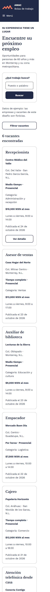
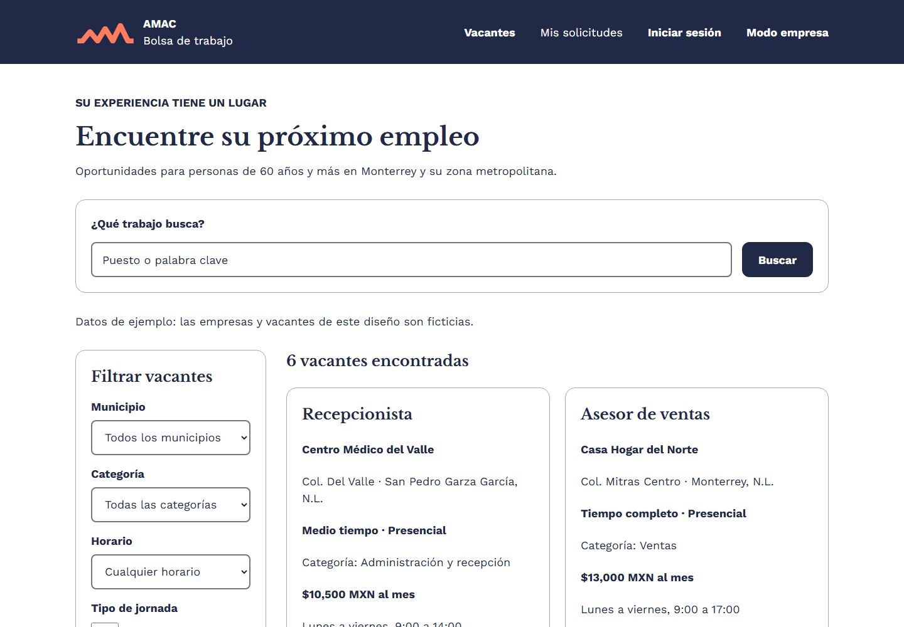
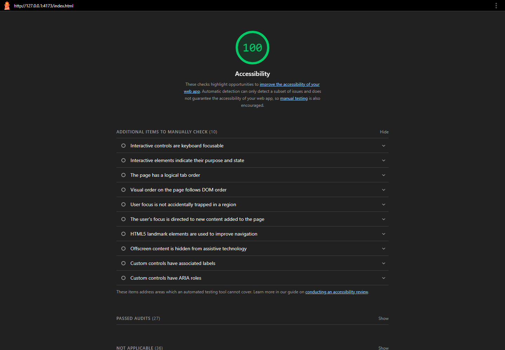

# AMAC · Entrega 2: HTML y CSS

## 1. Integrantes y aportaciones

| Integrante / usuario de GitHub | Trabajo realizado |

| Juan — `JuanPRamos2` | Aportó versiones de las páginas HTML. Realizó ajustes en Mis solicitudes y agregó el panel de empresa. Integró y actualizó el conjunto del proyecto, incorporando el README, las capturas de celular y escritorio y las evidencias de Lighthouse. |
| Samuel — `samuelh-g07` | Inicializó el repositorio. Aportó las primeras versiones del inicio de sesión y registro del candidato, creó Mis solicitudes y realizó ajustes posteriores en esas páginas. Agregó versiones del listado y detalle de vacante, los archivos base.css y variables.css y el logo. También integró Pull Requests en main. |
| Diego — `diegovelazquezgit` | Aportó el listado vacantes.html, las páginas menu.html y filtros.html, la imagen del logo y los cuatro archivos CSS: variables.css, base.css, layout.css y componentes.css. |

## 2. Paleta de colores y tipografías

Los colores y las tipografías se centralizan en `css/variables.css`
y se reutilizan en las demás hojas de estilo.

### Paleta de colores

| Variable CSS | Valor | Uso |
|---|---|---|
| `--color-principal` | `#202945` | Texto principal, encabezado y botones primarios |
| `--color-ayuda` | `#ff815c` | Fondo del acceso a ayuda y acentos |
| `--color-fondo` | `#ffffff` | Fondo general y superficies |
| `--color-info-fondo` | `#cae4ef` | Fondo de mensajes informativos |
| `--color-borde` | `#a8a8a8` | Bordes de tarjetas y separadores |
| `--color-borde-campo` | `#767676` | Bordes de los campos de formulario |
| `--color-error` | `#b3261e` | Indicadores de error |
| `--color-foco` | `#202945` | Contorno de foco sobre superficies claras |

Sobre el encabezado oscuro, el contorno de foco es blanco para
mantenerlo visible.

### Tipografías

| Variable CSS | Fuente | Alternativas | Uso |
|---|---|---|---|
| `--fuente-texto` | Work Sans | Arial, sans-serif | Texto, navegación y controles |
| `--fuente-titulos` | Libre Baskerville | Georgia, serif | Títulos y subtítulos |

- Texto base: `--texto-base: 1.125rem`, equivalente a 18 px con la
  configuración predeterminada del navegador.
- Título principal: `--texto-h1: 2rem` en celular y `2.5rem` en escritorio.
- Subtítulos: `--texto-h2: 1.5rem`.
- Se utilizan pesos de fuente 400 y 700.

## 3. Componentes reutilizables identificados

Estos elementos comparten clases CSS y pueden convertirse en
componentes de React en la siguiente entrega.

| Componente | Clases utilizadas | Función |
|---|---|---|
| Encabezado | `.encabezado` | Presentar la identidad y navegación |
| Identidad de AMAC | `.marca-header`, `.logo-header`, `.textos-marca` | Mostrar el logo y nombre |
| Navegación | `.nav-lista`, `.menu-movil`, `.menu-lista` | Acceder a las páginas del sitio |
| Contenedor | `.contenedor` | Mantener márgenes y ancho de contenido |
| Presentación de página | `.cabecera-pagina` | Agrupar título e introducción |
| Tarjeta general | `.tarjeta` | Presentar contenido dentro de un panel |
| Tarjeta de vacante | `.vacante` | Mostrar información de una oferta |
| Tarjeta de solicitud | `.solicitud` | Mostrar una solicitud y su estado |
| Rejilla de solicitudes | `.contenedor-solicitudes` | Distribuir las solicitudes |
| Botones | `.boton`, `.boton--primario`, `.boton--secundario`, `.boton--bloque` | Presentar acciones principales y secundarias |
| Campo de formulario | `.campo-formulario` | Agrupar etiqueta, control y ayuda |
| Grupo de campos | `.grupo`, `.grupo-opciones` | Organizar controles relacionados |
| Opción seleccionable | `.opcion` | Presentar casillas con etiquetas |
| Etiqueta de estado | `.etiqueta-estatus` y sus modificadores | Identificar estados de solicitudes y vacantes |
| Mensaje informativo | `.aviso-info` | Mostrar orientación |
| Indicador de resumen | `.resumen`, `.resumen__numero` | Mostrar cantidades del panel de empresa |
| Tabla de vacantes | `.tabla-vacantes` | Presentar las publicaciones de la empresa |
| Ayuda | `.ayuda` | Dar acceso a la ayuda de AMAC |
| Pie de página | `.pie` | Mostrar información institucional |

## 4. Capturas de index.html

### Celular

### Escritorio

## 5. Lighthouse — Accessibility

El reporte de Lighthouse incluido en el proyecto registra
**100/100 en Accessibility** para `index.html`.

El mínimo solicitado por la entrega es **90/100**.

