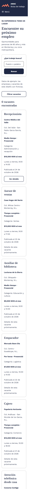
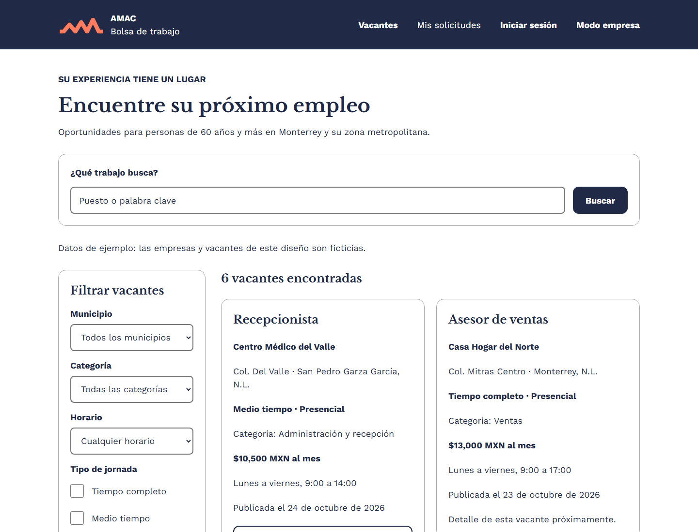
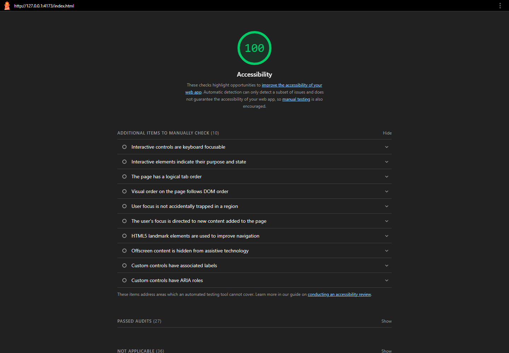

# AMAC · Bolsa de trabajo

Sitio de bolsa de trabajo para personas de 60 años y más. La entrega se mantiene
localmente en esta carpeta; no se ha integrado ni publicado.

## Estructura

```text
amac-web/
├── index.html
├── vacante.html
├── login.html
├── registro-candidato.html
├── mis-solicitudes.html
├── empresa-vacantes.html
├── menu.html
├── filtros.html
├── css/
│   ├── variables.css
│   ├── base.css
│   ├── layout.css
│   └── componentes.css
├── img/
│   └── logo-amac.png
├── capturas/
│   ├── listado-celular.png
│   ├── listado-escritorio.png
│   ├── lighthouse-accesibilidad.png
│   └── lighthouse-accesibilidad.report.html
└── README.md
```

Abra `index.html` en un navegador para iniciar la demostración.

## Páginas y recorrido de demostración

1. Listado de seis vacantes en `index.html`.
2. El detalle disponible es el de Recepcionista, en `vacante.html`.
3. “Postularme” lleva a `mis-solicitudes.html`.
4. `mis-solicitudes.html` presenta cuatro solicitudes de ejemplo.

La búsqueda y los filtros de puesto, municipio, categoría, horario, jornada y
modalidad son controles visuales: no filtran las tarjetas. Las categorías y los
horarios son datos propuestos para la demostración. En la vacante se incluyen
“Postularme”, “Guardar y continuar” y “Llamar”; no se procesan postulaciones ni
llamadas. Los botones “Cancelar” también son visuales.

El inicio de sesión, la creación de cuenta y las acciones del panel de empresa no
autentican, envían ni guardan datos. La fecha de nacimiento se limita al 9 de
noviembre de 1966 (umbral de 60 años al 9 de noviembre de 2026) y el teléfono
requiere diez dígitos.

## Estilos y componentes compartidos

Las ocho páginas cargan los mismos cuatro archivos CSS locales:

- `css/variables.css`: colores, tipografía, escala de espaciado y tamaños.
- `css/base.css`: estilos base, foco visible, elementos accesibles y controles.
- `css/layout.css`: encabezado, navegación, contenedores y rejillas responsivas.
- `css/componentes.css`: botones, tarjetas, formularios, etiquetas, avisos y tabla.

Componentes reutilizados: `.encabezado`, `.marca-header`, `.logo-header`,
`.textos-marca`, `.nav-lista`, `.contenedor`, `.cabecera-pagina`, `.tarjeta`,
`.vacante`, `.solicitud`, `.contenedor-solicitudes`, `.boton`,
`.campo-formulario`, `.grupo-opciones`, `.etiqueta-estatus`, `.aviso-info`,
`.ayuda` y `.pie`.

### Paleta

| Uso                 | Color     |
| ------------------- | --------- |
| Primario y texto    | `#202945` |
| Fondo               | `#ffffff` |
| Ayuda / énfasis     | `#ff815c` |
| Avisos informativos | `#cae4ef` |
| Bordes              | `#a8a8a8` |
| Borde de controles  | `#767676` |
| Errores             | `#b3261e` |

### Fuentes

- Títulos: Libre Baskerville, con Georgia como alternativa.
- Texto y controles: Work Sans, con Arial como alternativa.

## Equipo y aportaciones

Pendiente: agregar los nombres de las personas integrantes y sus aportaciones
confirmadas.

## Accesibilidad y revisión visual

- Páginas en español, con un único `h1`, viewport y etiquetas asociadas a controles.
- Las hojas de estilo incluyen foco visible y rejillas adaptables.
- En el navegador integrado no se observó desbordamiento horizontal a 320, 768,
  1024 y 1440 px.
- Se probó la navegación por teclado a través del encabezado, filtros y una
  tarjeta; los elementos enfocados muestran un contorno visible de 4 px.
- Se comprobó el zoom real del navegador al 200 % en `index.html`, sin
  desbordamiento horizontal.
- Capturas locales del listado:

  

  

- Lighthouse 13.6.0, categoría Accessibility en `index.html`: **100/100**, sin
  auditorías aplicables fallidas. El reporte HTML y los datos JSON están en
  `capturas/lighthouse-accesibilidad.report.html` y
  `capturas/lighthouse-accesibilidad.report.json`.

  

## Datos pendientes antes de una publicación

- Agregar integrantes y aportaciones.

## Mejoras futuras (fuera de esta entrega)

- Implementar búsqueda y filtros funcionales.
- Agregar detalles para las otras cinco vacantes.
- Implementar autenticación, registro y gestión de postulaciones.
- Habilitar llamadas solo si se dispone de números reales.
- Publicar en Vercel si se solicita.
